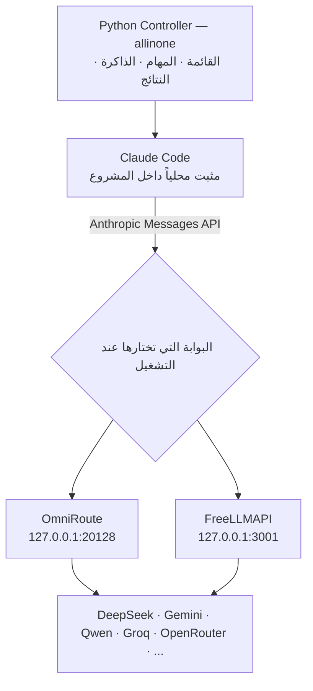

# Allinone for iPad

[تشغيل المضيف والعميل على الشبكة](IPAD.md)

# Allinone — Claude Code + OmniRoute + FreeLLMAPI

برنامج واحد يثبّت ثلاثة مكونات ويربطها ببعض:

- **Claude Code** هو أداة البرمجة التي تنفّذ المهام.
- **OmniRoute** و**FreeLLMAPI** بوابتان توصلان Claude Code بنماذج مثل DeepSeek وGemini وQwen وغيرها.

تختار عند كل تشغيل البوابة التي يأخذ منها Claude Code الأوامر. يدير ذلك كله **Python Controller** فيه قائمة ومهام وذاكرة، وكل جزء قابل للتعديل والإضافة.



## ما الذي يفعله

- **تثبيت كامل بأمر واحد**:
  - ينزّل نسخة محمولة من Node.js 24، وهو الإصدار الوحيد المتوافق مع البوابتين معاً. يتحقق من بصمتها، ولا يغيّر Node المثبت على جهازك.
  - يثبّت OmniRoute وFreeLLMAPI وClaude Code داخل مجلد `runtime/`.
- **اختيار البوابة عند التشغيل**:
  - يشغّل البوابة في الخلفية وينتظر حتى تجهز.
  - يقرأ مفتاحها تلقائياً.
  - يطلق Claude Code متصلاً بها، ثم يوقفها عند الخروج.
- **أدوات إضافية داخل Claude Code**:
  - ذاكرة دائمة مشتركة بين كل الجلسات والبوابات.
  - أداة `ask_model` لاستشارة نموذج آخر.
  - معلومات البوابة ونماذجها.
  - وكيل لمراجعة الكود.
  - أوامر `/allinone:...`.
- **مهام بدون واجهة**: `allinone run "..."` وطابور مهام، والنتائج محفوظة في قاعدة بيانات.
- **حرية تعديل كاملة**:
  - إعدادات بتعليقات عربية.
  - أدوات Python تكتبها بدالة واحدة.
  - Skills وAgents وHooks.
  - خوادم MCP، ومنها أدوات البوابتين نفسيهما.
  - تعديل الكود المصدري للبوابات مع الاحتفاظ بتعديلاتك عند التحديث.
  - إضافة بوابة ثالثة.

## المتطلبات

| | |
|---|---|
| النظام | Windows 10/11، macOS 13 أو أحدث، Linux (Ubuntu 20.04+ وDebian 10+) |
| Python | 3.10 أو أحدث (يعرض المثبّت على Windows تثبيته تلقائياً) |
| Git | مطلوب (يعرض المثبّت على Windows تثبيته تلقائياً) |
| Node.js | **لا تحتاج تثبيته**، فالبرنامج ينزّل نسخته الخاصة |
| المساحة | حوالي 2 إلى 3 GB |
| الذاكرة | 4 GB أو أكثر، و8 GB أو أكثر إن أردت بناء OmniRoute من الكود المصدري |

## التثبيت

### Windows

```powershell
git clone https://github.com/baghdadhost-wq/Allinone.git
cd Allinone
.\install.cmd
```

> في PowerShell يجب كتابة `.\` قبل اسم الملف (`.\install.cmd` و`.\allinone.cmd`)، لأن PowerShell لا يشغّل الملفات من المجلد الحالي بدونها. في نافذة cmd العادية يكفي `install.cmd`.

يفحص `install.cmd` وجود Python وGit، ويعرض تثبيتهما عبر `winget` إن لم يجدهما. بعدها ينزّل Node.js وOmniRoute وFreeLLMAPI وClaude Code، ثم يسألك إن كنت تريد إضافة `allinone` إلى PATH.

### macOS / Linux

```bash
git clone https://github.com/baghdadhost-wq/Allinone.git
cd Allinone
./install.sh
```

> المستودع خاص، لذا يطلب `git clone` تسجيل الدخول إلى GitHub. الطريقة الأسهل هي `gh auth login` أو GitHub Desktop.

## التشغيل

```bash
.\allinone.cmd   # على Windows (أو allinone فقط بعد إضافته إلى PATH وفتح طرفية جديدة)
./allinone        # على macOS / Linux
```

تظهر قائمة البوابات مع حالة كل منها:

```
  1) OmniRoute    ● يعمل     http://127.0.0.1:20128
  2) FreeLLMAPI   ○ متوقف    http://127.0.0.1:3001

  p) المشروع   d) لوحة التحكم   s) الحالة   t) المهام   i) تثبيت/تحديث   l) اللغة   q) خروج
اختر البوابة لـ Claude Code [1]:
```

اختر رقم البوابة، ثم اكتب النموذج أو اضغط Enter للافتراضي (`?` تعرض قائمة النماذج). يفتح بعدها Claude Code في مجلد المشروع متصلاً بالبوابة المختارة. عند خروجك من Claude Code تعود إلى القائمة.

يعمل Claude Code على المجلد الذي شغّلت منه `allinone`، ويمكنك تغييره من القائمة بالحرف `p`، أو بالأمر `allinone start omniroute -p D:\my-project`.

### أول مرة: أضف مزوّداً واحداً على الأقل

البوابتان لا تملكان أي نموذج حتى تضيف مفتاح مزوّد واحد على الأقل، مثل Gemini أو Groq أو OpenRouter أو DeepSeek.

**OmniRoute**
1. نفّذ `allinone dashboard omniroute`، أو اختر `d` من القائمة.
2. سجّل الدخول بكلمة المرور التي يعرضها البرنامج. هي محفوظة في `data/secrets.json`، ويمكنك تغييرها من Settings → Security.
3. من **Providers** أضف مفاتيح مزوديك، أو سجّل الدخول بحساباتك.
4. اختر OmniRoute من القائمة. يستخدم Claude Code النموذج `auto`، أي أن OmniRoute يختار أفضل مزوّد متاح ويتحول تلقائياً عند الفشل.

**FreeLLMAPI**
1. نفّذ `allinone dashboard freellmapi`.
2. في أول زيارة أنشئ حساب لوحة التحكم، وهو محلي على جهازك.
3. من صفحة **Keys** أضف مفاتيح المزودين، ورتّب **Fallback Chain** كما تريد.
4. اختر FreeLLMAPI من القائمة. يقرأ Allinone المفتاح الموحّد `freellmapi-…` تلقائياً، فلا حاجة لنسخه.

## الأوامر

| الأمر | الوظيفة |
|---|---|
| `allinone` | القائمة التفاعلية |
| `allinone omniroute` / `allinone freellmapi` | تشغيل Claude Code مباشرة عبر بوابة |
| `allinone start freellmapi -m <model> -p <folder> -- --continue` | مع نموذج ومجلد، وما بعد `--` يذهب إلى Claude Code |
| `allinone run "اكتب اختبارات لملف utils.py"` | تنفيذ مهمة بلا واجهة وحفظ النتيجة (`-g` لاختيار البوابة) |
| `allinone run --resume 3 "أكمل"` | متابعة جلسة المهمة رقم 3 |
| `allinone task add "..."` ثم `allinone task work` | طابور مهام يُنفَّذ بالترتيب |
| `allinone task list` / `allinone task show 3` | عرض المهام ونتائجها |
| `allinone memory add "..."` / `search` / `list` / `forget` | الذاكرة المشتركة (يستخدمها Claude أيضاً) |
| `allinone gateway start\|stop\|status\|logs [name]` | التحكم بالبوابات وسجلاتها (`logs -f` للمتابعة) |
| `allinone dashboard [name]` | فتح لوحة تحكم البوابة |
| `allinone models [name]` | عرض النماذج المتاحة |
| `allinone key <name> [KEY]` | عرض أو حفظ مفتاح بوابة |
| `allinone install [all\|node\|claude\|omniroute\|freellmapi]` | التثبيت |
| `allinone update [...] [--latest]` | التحديث |
| `allinone customize save\|status\|diff <gateway>` | حفظ تعديلاتك على كود البوابة |
| `allinone doctor` | فحص كل شيء |
| `allinone lang ar\|en` | لغة الواجهة |

## داخل Claude Code

| | |
|---|---|
| `/allinone:remember <نص>` | حفظ معلومة في الذاكرة الدائمة |
| `/allinone:recall <كلمات>` | البحث في الذاكرة |
| `/allinone:gateway` | البوابة والنموذج الحاليان وقائمة النماذج |
| `/model <id>` | تغيير النموذج أثناء الجلسة |
| `@agent-allinone:reviewer` | مراجعة التغييرات الأخيرة |
| أدوات MCP | `memory_save` · `memory_search` · `ask_model` · `gateway_models` · `task_list` · … وكل ما تضيفه في `claude/mcp/tools/` |

## التخصيص

كل ما يلي في ملفات يمكنك تعديلها، والتفاصيل والأمثلة في **[docs/CUSTOMIZE.md](docs/CUSTOMIZE.md)**:

| ماذا | أين |
|---|---|
| المنافذ، النموذج لكل بوابة، الإصدارات، طريقة التثبيت | `config/allinone.jsonc` (إعداداتك الشخصية في `config/local.jsonc`) |
| خيارات البوابة الأصلية (ضغط السياق، طلب مفتاح...) | `config/gateways/omniroute.env` · `config/gateways/freellmapi.env` |
| أدوات Python جديدة لـ Claude | ملف `.py` في `claude/mcp/tools/` |
| خوادم MCP (ومنها أدوات OmniRoute وFreeLLMAPI نفسيهما) | `config/mcp.jsonc` |
| Skills وأوامر وAgents | `claude/plugins/allinone/`، أو أي مجلد plugin جديد في `claude/plugins/` |
| Hooks والصلاحيات وإعدادات Claude Code | `claude/settings.json` |
| التعليمات التي يتلقاها Claude في بداية كل جلسة | `claude/context.md` |
| تعديل الكود المصدري لـ OmniRoute أو FreeLLMAPI | `runtime/<gateway>/`، ثم `allinone customize save`، وتُحفظ التعديلات في `customizations/` |
| بوابة ثالثة (LiteLLM، claude-code-router، خادم آخر...) | قسم `gateways` في `config/allinone.jsonc` بالنوع `custom` |

## هيكل المستودع

```
allinone.py · allinone.cmd · allinone     نقطة التشغيل
install.cmd · install.ps1 · install.sh    المثبّتات
controller/          Python Controller (القائمة، البوابات، Claude Code، المهام، الذاكرة)
config/              الإعدادات (allinone.jsonc · mcp.jsonc · gateways/*.env)
claude/              تخصيص Claude Code: settings.json · context.md · hooks/ · mcp/ · plugins/
customizations/      تعديلاتك على كود البوابتين (ملفات patch)
docs/                الشرح التفصيلي
tests/               اختبارات تلقائية (python -m unittest discover -s tests)
runtime/   ← غير محفوظ في git: Node.js والبوابتان وClaude Code المثبتة
data/      ← غير محفوظ في git: قواعد البيانات والسجلات والأسرار والذاكرة
```

## التحديث

```bash
git pull                      # تحديث Allinone نفسه
allinone update               # إعادة تثبيت المكونات بالإصدارات المحددة في الإعدادات
allinone update omniroute --latest
```

إصدارات البوابتين مثبّتة في `config/allinone.jsonc`، ما يضمن أن ما يعمل اليوم يبقى يعمل. لرفعها عدّل `version` أو `ref` هناك، أو استخدم `--latest`. تعديلاتك على الكود المصدري تُطبَّق تلقائياً بعد كل تحديث.

## الحذف (إلغاء التثبيت)

كل ما يثبّته Allinone موجود داخل مجلده فقط: Node.js والبوابتان وClaude Code في `runtime/`، والبيانات في `data/`. لا يثبّت شيئاً في النظام، لذا يكفي حذف المجلد. الخطوات:

**1. أوقف البوابات إن كانت تعمل:**

```powershell
.\allinone.cmd gateway stop omniroute
.\allinone.cmd gateway stop freellmapi
```

**2. احذف Allinone من PATH** (فقط إن وافقت على إضافته أثناء التثبيت). نفّذ في PowerShell عادي:

```powershell
$p = [Environment]::GetEnvironmentVariable("Path", "User")
[Environment]::SetEnvironmentVariable("Path", (($p -split ";") | Where-Object { $_ -and $_ -notlike "*\Allinone" }) -join ";", "User")
```

**3. احذف المجلد.** اخرج منه أولاً، وأغلق أي برنامج يستخدمه (مثل VS Code)، ثم:

```powershell
cd $HOME
Remove-Item -Recurse -Force "$HOME\Allinone"
```

على macOS / Linux:

```bash
./allinone gateway stop omniroute; ./allinone gateway stop freellmapi
cd ~ && rm -rf ~/Allinone
rm -f ~/.local/bin/allinone      # إن كنت أنشأت هذا الاختصار
```

> **تنبيه:** حذف المجلد يحذف أيضاً `data/`، وفيه مفاتيح المزودين وكلمات مرور لوحات التحكم والذاكرة والمهام. إن أردت الاحتفاظ بها فانسخ المجلد `data` إلى مكان آخر أولاً، ثم ضعه في المجلد الجديد بعد إعادة التثبيت.

**حذف التثبيت فقط مع الإبقاء على بياناتك وإعداداتك:** احذف المجلد `runtime` وحده، وعند الحاجة أعد التثبيت بالأمر `.\install.cmd`.

**إن كان المجلد داخل `C:\Windows\System32`** (يحدث عند تنزيله من PowerShell يعمل كمسؤول): افتح PowerShell **كمسؤول** وانسخ هذا المسار حرفياً دون أي تغيير:

```powershell
Remove-Item -Recurse -Force C:\Windows\System32\Allinone
```

## حل المشاكل

ابدأ بـ `allinone doctor`، ثم راجع **[docs/TROUBLESHOOTING.md](docs/TROUBLESHOOTING.md)**. سجلات البوابات في `data/logs/` (`allinone gateway logs omniroute`).

## ملاحظات مهمة

- **النماذج ليست Claude.** يعمل Claude Code هنا بنماذج أخرى، ومستوى أدائها في استدعاء الأدوات وتعديل الملفات يتفاوت. للمهام الطويلة اختر نموذجاً قوياً في استدعاء الأدوات.
- **الحدود المجانية وشروط المزودين.** علاقتك بكل مزوّد تحكمها شروطه حتى عند المرور عبر البوابة.
  - FreeLLMAPI مخصص للتجربة الشخصية.
  - OmniRoute يستبعد من `auto` افتراضياً المزودين المصنفين `tos: avoid`.
- **الأمان.**
  - البوابتان تستمعان على `127.0.0.1` فقط.
  - كلمات المرور والمفاتيح المولّدة محفوظة في `data/secrets.json`، والمجلد `data/` مستثنى من git فلا ترفعه.
  - لا تغيّر `ENCRYPTION_KEY` الخاص بـ FreeLLMAPI بعد حفظ المفاتيح.
- **التراخيص.**
  - OmniRoute وFreeLLMAPI مفتوحا المصدر بترخيص MIT.
  - Claude Code برنامج من Anthropic يُثبَّت من حزمته الرسمية على npm ويخضع لشروط Anthropic.
  - التفاصيل في [THIRD_PARTY_NOTICES.md](THIRD_PARTY_NOTICES.md).

---

### English summary

Allinone installs **Claude Code**, **OmniRoute** and **FreeLLMAPI** side by side and lets you pick, at every launch, which gateway Claude Code talks to.

- **Controller**: a stdlib-only Python controller (`allinone`) does the work:
  - provisions a portable Node.js 24, the only line both gateways support;
  - installs the gateways (OmniRoute from npm, FreeLLMAPI from source) and Claude Code locally under `runtime/`;
  - starts the chosen gateway on `127.0.0.1`, discovers its key, and launches Claude Code with `ANTHROPIC_BASE_URL`/`ANTHROPIC_AUTH_TOKEN`, a per-session `--settings`, `--mcp-config` and `--plugin-dir`.
- **What you get**:
  - Python MCP tools: shared memory, `ask_model`, gateway info, and your own `@tool` functions;
  - a plugin with skills and a reviewer agent;
  - a SessionStart context hook;
  - headless runs and a task queue stored in SQLite;
  - a patch workflow that keeps your edits to the gateways' source across updates.
- **Get started**: run `install.cmd` (Windows) or `./install.sh`, then `allinone`. See `docs/CUSTOMIZE.md` and `docs/TROUBLESHOOTING.md`.
